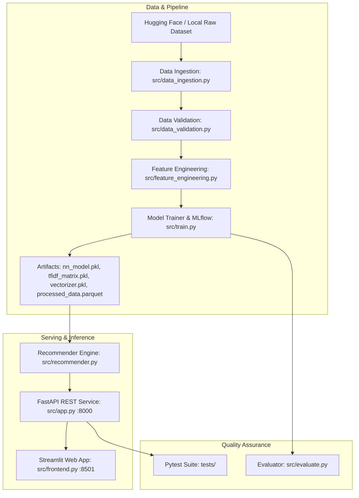

# ⚡ AppliancePulse: E-Commerce Product Recommender

[](https://www.python.org/downloads/)
[](https://fastapi.tiangolo.com)
[](https://streamlit.io)
[](https://www.docker.com)
[](https://opensource.org/licenses/MIT)

An enterprise-grade, end-to-end Machine Learning recommendation and semantic discovery platform built on the **Amazon Appliances Dataset** (65,743 indexed products). 

AppliancePulse combines **TF-IDF vector embeddings** and **Cosine Nearest Neighbors** to deliver sub-second product recommendations, smart semantic requirements matching, interactive REST APIs, and a modern Streamlit web storefront.

---

## 🌟 Key Features

- **🎯 Dual Recommendation Engines**:
  - **Item-to-Item Similarity**: Recommends accessories, replacements, and similar models given an existing product title or Amazon ASIN.
  - **Natural Language Semantic Search**: Vectorizes arbitrary user queries (e.g., *"whisper quiet countertop ice maker for office"*) and identifies nearest neighbors in TF-IDF cosine vector space.
- **⚡ High-Performance Parquet Storage**:
  - Optimized catalog representation (`processed_data.parquet` ~68MB) loaded in `< 0.25s`, bypassing GitHub's 100MB file limit.
- **🚀 Production FastAPI Backend**:
  - Fully typed Pydantic schemas, Swagger UI (`/docs`), health check endpoints, CORS middleware, and keyword search.
- **🎨 Modern Streamlit Storefront**:
  - High-aesthetic e-commerce UI featuring live backend health probes, product images, rating badges, match percentage indicators, and top-K parameter sliders.
- **🐳 Containerized Deployment**:
  - Single-command orchestration with Docker Compose for both backend API and frontend UI.
- **🧪 Automated Test Suite**:
  - Unit and integration tests covering data validation, text cleaning, recommendation math, and API endpoints.

---

## 🏗️ Architecture



---

## 📁 Repository Structure

```
E-Commerce/
├── artifacts/
│   ├── data/
│   │   ├── processed_data.parquet    # Optimized compressed catalog (65,743 items)
│   │   └── processed_data.csv        # Serving CSV view
│   └── models/
│       ├── nn_model.pkl              # Fitted NearestNeighbors model
│       ├── tfidf_matrix.pkl          # Sparse TF-IDF product matrix (65743 x 10000)
│       └── vectorizer.pkl            # Trained TF-IDF Vectorizer
├── notebooks/
│   └── eda.ipynb                     # Exploratory Data Analysis & experiments
├── src/
│   ├── __init__.py
│   ├── app.py                        # FastAPI REST API endpoints
│   ├── data_ingestion.py             # Local & Hugging Face data loader
│   ├── data_validation.py            # Data quality & schema constraints
│   ├── evaluate.py                   # Recommendation evaluation metrics
│   ├── feature_engineering.py        # Text sanitization & feature merging
│   ├── frontend.py                   # Streamlit e-commerce user interface
│   ├── logger.py                     # Centralized logging configuration
│   ├── pipeline.py                   # End-to-end ML pipeline runner
│   ├── recommender.py                # Dual-mode recommendation core
│   └── train.py                      # TF-IDF & Nearest Neighbors trainer
├── tests/
│   ├── __init__.py
│   ├── test_api.py                   # FastAPI endpoint integration tests
│   ├── test_data_validation.py       # Validation logic unit tests
│   ├── test_feature_engineering.py   # Text preprocessing unit tests
│   └── test_recommender.py           # Recommender engine tests
├── docker-compose.yml                # Multi-container orchestration
├── Dockerfile                        # Production container build
├── main.py                           # CLI entrypoint for pipeline & serving
├── requirements.txt                  # Python dependencies
└── test.py                           # Quick recommender verification script
```

---

## 🚀 Quick Start Guide

### 1. Prerequisites & Environment Setup
Using Conda:
```bash
# Clone the repository
git clone https://github.com/themdanas/product-recommendor.git
cd product-recommendor

# Create and activate environment
conda create -n eco_env python=3.12 -y
conda activate eco_env

# Install dependencies
pip install -r requirements.txt
```

### 2. Run the Full ML Pipeline
To ingest data, validate constraints, generate features, and fit the models:
```bash
python main.py --pipeline
```

To run individual pipeline stages:
```bash
python main.py --validate    # Validate dataset constraints
python main.py --ingest      # Run ingestion only
```

---

## 🌐 Running Locally

### Start the FastAPI Backend
```bash
python main.py --serve
# API will be available at http://localhost:8000
# Interactive Swagger docs: http://localhost:8000/docs
```

### Start the Streamlit Frontend UI
In a separate terminal:
```bash
python main.py --frontend
# Streamlit interface available at http://localhost:8501
```

---

## 🐳 Running with Docker Compose

Run both the FastAPI backend and Streamlit frontend in orchestrated containers:
```bash
docker compose up --build
```
- **Streamlit Web UI**: [http://localhost:8501](http://localhost:8501)
- **FastAPI Documentation**: [http://localhost:8000/docs](http://localhost:8000/docs)
- **Health Check**: [http://localhost:8000/health](http://localhost:8000/health)

---

## 📡 API Reference

### Health Status
```bash
curl -X GET "http://localhost:8000/health"
```
**Response (200 OK)**:
```json
{
  "status": "healthy",
  "version": "2.0.0",
  "model_loaded": true,
  "total_products": 65743,
  "stats": {
    "total_products": 65743,
    "vocabulary_size": 10000,
    "average_rating": 4.18,
    "matrix_shape": [65743, 10000]
  }
}
```

### Item-to-Item Recommendation
```bash
curl -X GET "http://localhost:8000/recommend?product_title=Ice%20Maker&top_k=3"
```

### Semantic Natural Language Search
```bash
curl -X GET "http://localhost:8000/recommend/query?query=countertop%20portable%20ice%20maker&top_k=3"
```

### Keyword Search
```bash
curl -X GET "http://localhost:8000/search?query=Samsung&limit=5"
```

---

## 🧪 Testing

Execute the automated test suite with `pytest`:
```bash
pytest tests/ -v
```

---

## 📊 Dataset Attribution
This project utilizes the **McAuley-Lab Amazon Reviews 2023** Appliance metadata dataset:
- **Reference**: Hou, Y., Li, J., He, Z., Yan, A., Chen, X., & McAuley, J. (2024). *Bridging Language and Items for Retrieval and Recommendation.*
- **Dataset Hub**: [McAuley-Lab/Amazon-Reviews-2023](https://huggingface.co/datasets/McAuley-Lab/Amazon-Reviews-2023)
