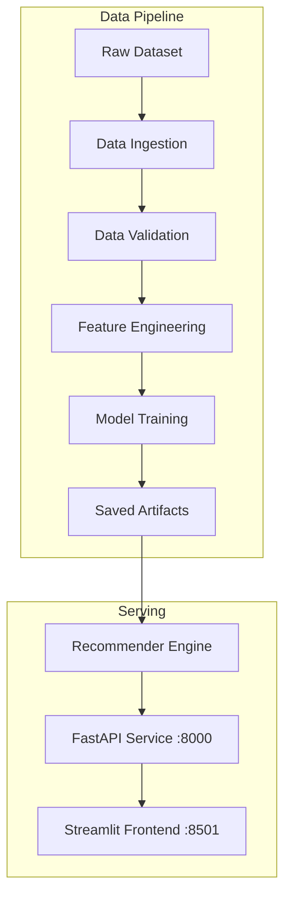

# Product Recommender

A content-based recommendation system for e-commerce appliances built using TF-IDF vectorization and Nearest Neighbors with cosine similarity on the Amazon Appliances dataset.

---

## Features

- **Item-to-Item Similarity**: Recommends similar products given a product title or ASIN.
- **Natural Language Query Search**: Vectorizes free-text user search queries to find the closest matching products in TF-IDF vector space.
- **FastAPI Backend**: REST API with endpoints for search, recommendations, and health checks.
- **Streamlit Frontend**: Minimal web interface for interactive product discovery.
- **Docker Support**: Containerized backend and frontend services via Docker Compose.
- **Test Suite**: Unit and integration tests covering data validation, preprocessing, model inference, and API endpoints.

---

## Architecture



---

## Project Structure

```
.
├── artifacts/
│   ├── data/
│   │   ├── processed_data.parquet    # Processed dataset
│   │   └── processed_data.csv
│   └── models/
│       ├── nn_model.pkl              # Fitted NearestNeighbors model
│       ├── tfidf_matrix.pkl          # TF-IDF matrix
│       └── vectorizer.pkl            # Fitted vectorizer
├── notebooks/
│   └── eda.ipynb                     # Exploratory Data Analysis
├── src/
│   ├── app.py                        # FastAPI endpoints
│   ├── data_ingestion.py             # Data loading logic
│   ├── data_validation.py            # Data quality checks
│   ├── evaluate.py                   # Evaluation metrics
│   ├── feature_engineering.py        # Text processing
│   ├── frontend.py                   # Streamlit UI
│   ├── logger.py                     # Logging setup
│   ├── pipeline.py                   # Pipeline runner
│   ├── recommender.py                # Core recommendation logic
│   └── train.py                      # Training script
├── tests/
│   ├── test_api.py                   # API endpoint tests
│   ├── test_data_validation.py       # Validation tests
│   ├── test_evaluator.py             # Evaluator tests
│   ├── test_feature_engineering.py   # Preprocessing tests
│   └── test_recommender.py           # Recommender tests
├── docker-compose.yml
├── Dockerfile
├── main.py                           # CLI entrypoint
└── requirements.txt
```

---

## Getting Started

### 1. Installation

```bash
# Clone repository
git clone https://github.com/themdanas/product-recommendor.git
cd product-recommendor

# Create and activate environment
conda create -n eco_env python=3.12 -y
conda activate eco_env

# Install dependencies
pip install -r requirements.txt
```

### 2. Pipeline Execution

Run the complete training pipeline:
```bash
python main.py --pipeline
```

Run specific stages:
```bash
python main.py --validate    # Run data validation checks
python main.py --ingest      # Run ingestion only
```

---

## Running the Application

### Backend API
```bash
python main.py --serve
```
The API runs at `http://localhost:8000`. Interactive documentation is available at `http://localhost:8000/docs`.

### Frontend UI
```bash
python main.py --frontend
```
The Streamlit interface runs at `http://localhost:8501`.

### Docker Compose
Run both services in containers:
```bash
docker compose up --build
```

---

## API Endpoints

| Method | Endpoint | Description |
|---|---|---|
| `GET` | `/health` | Service health status and catalog metrics |
| `GET` | `/search?query={keyword}&limit=20` | Title keyword search |
| `GET` | `/recommend?product_title={title}&top_k=10` | Item-to-item recommendations |
| `GET` | `/recommend/query?query={prompt}&top_k=10` | Semantic query recommendations |
| `GET` | `/product/{asin}` | Product metadata lookup by ASIN |

---

## Testing

Run the test suite:
```bash
pytest tests/ -v
```

---

## Dataset Reference

Uses the **McAuley-Lab Amazon Reviews 2023** Appliance metadata dataset:
- Hou, Y., Li, J., He, Z., Yan, A., Chen, X., & McAuley, J. (2024). *Bridging Language and Items for Retrieval and Recommendation.*
- Hugging Face: [McAuley-Lab/Amazon-Reviews-2023](https://huggingface.co/datasets/McAuley-Lab/Amazon-Reviews-2023)
